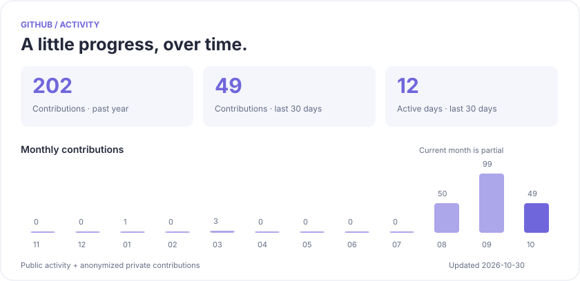

# Hi, I'm HE YUXIN 👋

Student at the **University of Electronic Science and Technology of China (UESTC)**.

Learning, experimenting, and building — one step at a time.

### Activity at a glance

<picture>
  <source media="(prefers-color-scheme: dark)" srcset="assets/activity-dark.svg">
  <source media="(prefers-color-scheme: light)" srcset="assets/activity-light.svg">
  
</picture>

### Latest public code updates

| Repository | Latest push | Language |
| :--- | :--- | :--- |
| [MarsCode-Winter-Camp](https://github.com/xinyuyaoer/MarsCode-Winter-Camp) | 2025-02-14 | — |
| [InternshipNote](https://github.com/xinyuyaoer/InternshipNote) | 2025-02-10 | — |
| [business-card](https://github.com/xinyuyaoer/business-card) | 2024-11-20 | CSS |

Public, original repositories · sorted by latest push · refreshed daily. Private repository details stay private.

[Browse public repositories](https://github.com/xinyuyaoer?tab=repositories&amp;type=source) · [Contribution history](https://github.com/xinyuyaoer?tab=overview#year-list-container)
